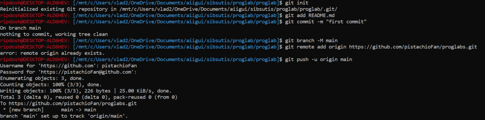
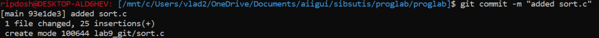
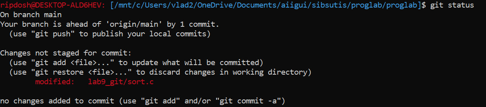
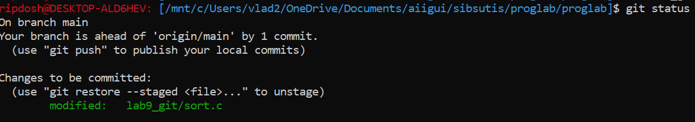
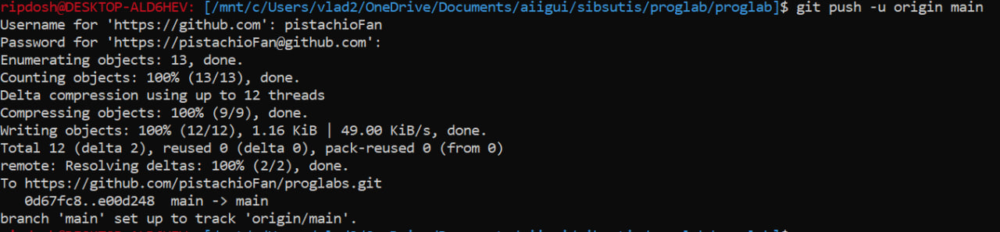
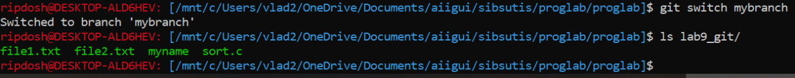

# Скриншотики

Начальная инициализация репозитория

Здесь и далее вместо ветки master будет ветка main

Первоначальный лог

Добавили директорию для выполнения работы и файл sort.c

второй статус

делаем комит

третий статус

внесем изменения в файл sort.c и четвертый статус

добавим изменение файла

пятый статус

шестой статус после второго изменения файла

текущий лог после комита

добавляем новые изменения и комитим

пушим в репо

создадим ветку и посмотрим все ветки

переключимся на новосозданную ветку

можно увидеть изменения статуса при переключении между ветками, видно, что новая ветка существует только локально

создадим 2 новых файла по заданию

добавив и закомитев первый файл, выводим лог

не замечаем пункт про перключение на main и создаем и комитим файл 2 в не ту ветку

заметив ошибку переключаемся на main

создаем уже тут третий файл, комитим его и выводим лог

переключаемся на новую ветку, и видим, что третий файл, созданный в главной ветке больше не виден

оценним разницу между ветками
