# Скриншотики

Начальная инициализация репозитория

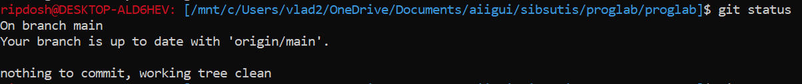
Здесь и далее вместо ветки master будет ветка main

Первоначальный лог

Добавили директорию для выполнения работы и файл sort.c

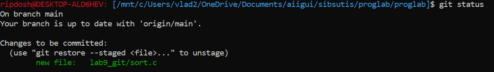
второй статус

делаем комит

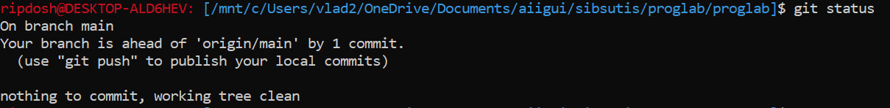
третий статус

внесем изменения в файл sort.c и четвертый статус

добавим изменение файла

пятый статус

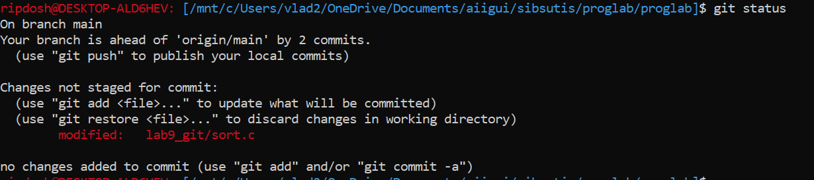
шестой статус после второго изменения файла

текущий лог после комита

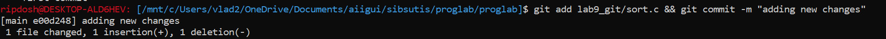
добавляем новые изменения и комитим

пушим в репо

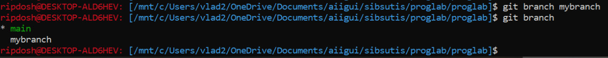
создадим ветку и посмотрим все ветки

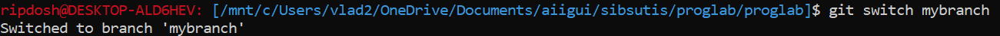
переключимся на новосозданную ветку

можно увидеть изменения статуса при переключении между ветками, видно, что новая ветка существует только локально

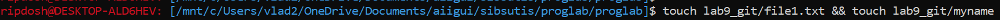
создадим 2 новых файла по заданию

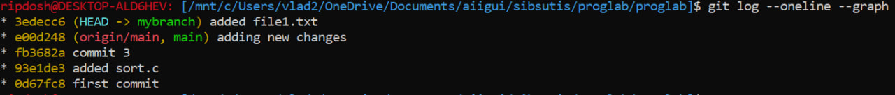
добавив и закомитев первый файл, выводим лог

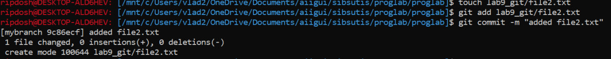
не замечаем пункт про перключение на main и создаем и комитим файл 2 в не ту ветку

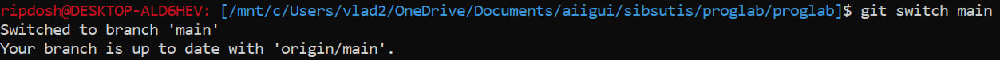
заметив ошибку переключаемся на main

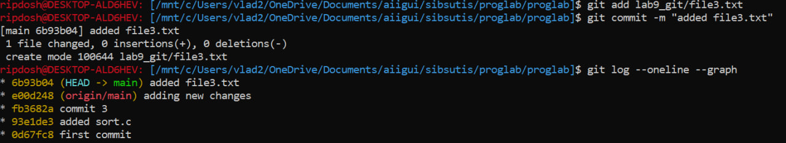
создаем уже тут третий файл, комитим его и выводим лог

переключаемся на новую ветку, и видим, что третий файл, созданный в главной ветке больше не виден

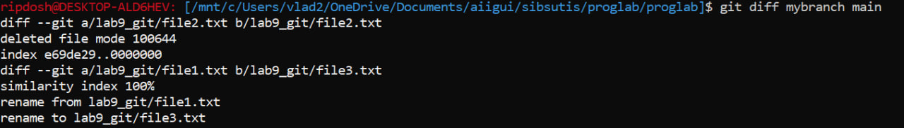
оценним разницу между ветками
